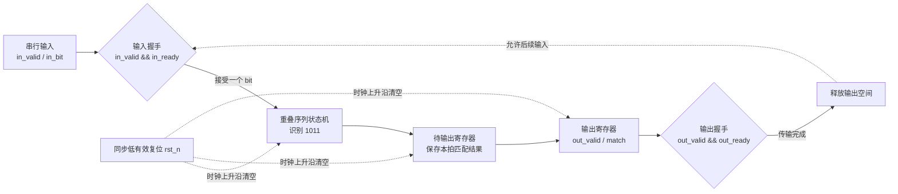
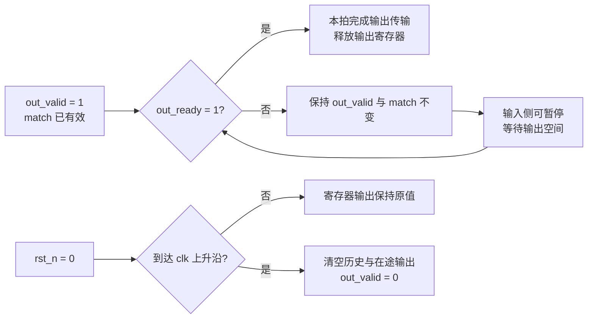
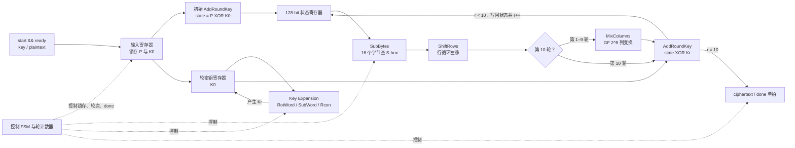
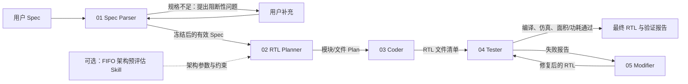
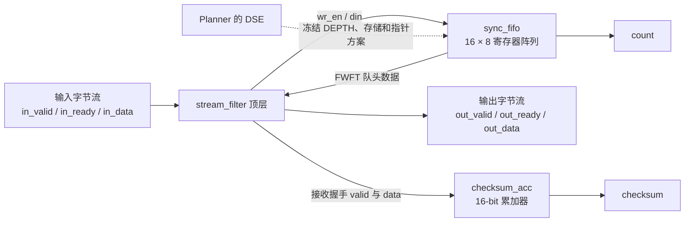
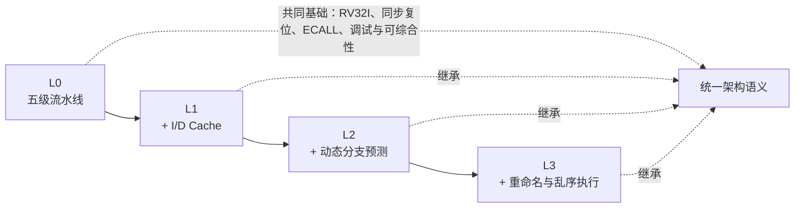
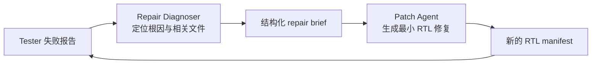

# AI EDA 课程实验讲义

## 第 0 章 实验概览

本实验依次学习 API 调用、Prompt 设计和 Agent 工程化；前一阶段的产出会成为后一阶段的输入。

| 模块 | 教学内容 | 实践 / 作业 | 学习目标 |
| --- | --- | --- | --- |
| API 调用 | Python、模型参数、思考与上下文 | 三个参数小实验 | 发起可复现调用，读懂 token 和完成原因 |
| Prompt | 将电路规格写成可验证 Prompt | P1–P5；AES-128 Prompt 作业 | 明确接口、时序、复位和验收条件 |
| Agent | Parser → Planner → Coder → Tester → Modifier | FIFO 演示；RISC-V Agent 重构 | 用 artifact、TB、PPA 和 benchmark 管理工程闭环 |

按 API → Prompt → Agent 的顺序完成，并保存模型参数、生成结果和测试报告。

## 第一章 实验前准备

### 1.1 获取项目

在终端执行：

```sh
# 下载课程项目
git clone https://github.com/K1ssMe520/THU_AI_EDA_2026.git

# 进入项目根目录，后续命令都在这里执行
cd THU_AI_EDA_2026
```

### 1.2 安装依赖

本实验支持 **Ubuntu 22.04+** 与 **macOS**。选择对应平台的命令安装 Python、Icarus Verilog、Yosys 和 OpenSTA；它们分别用于 API 调用、TB 仿真、面积和功耗评估。

#### Ubuntu 22.04+

```sh
sudo apt update
sudo apt install -y python3 python3-venv python3-pip iverilog yosys git cmake g++ swig tcl-dev libeigen3-dev bison flex
python3 --version

# 在项目根目录创建 Python 环境
python3 -m venv .venv
.venv/bin/python -m pip install --upgrade pip
.venv/bin/python -m pip install -r requirements.txt

# 构建 CUDD 和 OpenSTA；两者安装到 $HOME/.local
(
  cd "$HOME"
  git clone https://github.com/cuddorg/cudd.git
  cd cudd
  git checkout 3.0.0
  touch aclocal.m4 configure config.h.in Makefile.in
  ./configure --prefix="$HOME/.local"
  make -j"$(nproc)"
  make install
)

(
  cd "$HOME"
  git clone https://github.com/parallaxsw/OpenSTA.git
  cd OpenSTA
  mkdir -p build && cd build
  cmake -DCMAKE_BUILD_TYPE=Release -DCUDD_DIR="$HOME/.local" -DCMAKE_INSTALL_PREFIX="$HOME/.local" ..
  make -j"$(nproc)"
  make install
)

# 让工作台找到 sta，并验证工具可用
mkdir -p .tools
ln -sfn "$HOME/.local" .tools/opensta
export PATH="$HOME/.local/bin:$PATH"
command -v iverilog vvp yosys sta
```

#### macOS

```sh
# 已安装 Homebrew 时跳过第一行
/bin/bash -c "$(curl -fsSL https://raw.githubusercontent.com/Homebrew/install/HEAD/install.sh)"
brew install icarus-verilog yosys
python3 --version

# 在项目根目录创建 Python 环境
python3 -m venv .venv
.venv/bin/python -m pip install --upgrade pip
.venv/bin/python -m pip install -r requirements.txt

# 构建 OpenSTA；Brewfile 会安装 CUDD、Tcl、flex、bison 等依赖
(
  cd "$HOME"
  git clone https://github.com/parallaxsw/OpenSTA.git
  cd OpenSTA
  brew bundle install
  export PATH="$(brew --prefix bison)/bin:$(brew --prefix flex)/bin:$PATH"
  export CMAKE_INCLUDE_PATH="$(brew --prefix flex)/include"
  export CMAKE_LIBRARY_PATH="$(brew --prefix flex)/lib;$(brew --prefix bison)/lib"
  mkdir -p build && cd build
  cmake -DCMAKE_BUILD_TYPE=Release -DCUDD_DIR="$(brew --prefix cudd)" -DTCL_LIBRARY="$(brew --prefix tcl-tk@8)/lib/libtcl8.6.dylib" -DCMAKE_INSTALL_PREFIX="$HOME/.local" ..
  make -j"$(sysctl -n hw.ncpu)"
  make install
)

mkdir -p .tools
ln -sfn "$HOME/.local" .tools/opensta
export PATH="$HOME/.local/bin:$PATH"
command -v iverilog vvp yosys sta
```

#### 常见问题

- CUDD、OpenSTA 安装在 `$HOME/.local`；新终端需重新执行 `export PATH="$HOME/.local/bin:$PATH"`（macOS 可写入 `~/.zshrc`）。工作台也会通过 `.tools/opensta` 查找 `sta`。
- 若 `$HOME/cudd` 或 `$HOME/OpenSTA` 已存在，先改名或删除后再 `git clone`。CUDD 报 `aclocal-1.14` 时，上面命令中的 `touch` 已是常见修复；仍失败再安装 `autoconf automake libtool` 并执行 `autoreconf -fi`。
- 请使用 Ubuntu 22.04+ 或 macOS，并保持网络可用；OpenSTA 构建需要下载依赖。Ubuntu 侧需要 C++20 编译器。

### 1.3 项目目录结构

安装完成后，项目中最常用的目录如下（`.venv`、`.tools`、`.api_key` 和 `runs/` 为本机生成内容，通常不提交）：

```text
THU_AI_EDA_2026/
├── ai_eda/                 # Python 应用
│   ├── model/              # API 客户端与 Prompt 组装
│   ├── prompt/             # API 参数实验
│   ├── agent/              # Parser、Planner、Coder、Tester、Modifier
│   ├── rtl/                # 仿真、综合、功耗评估
│   └── web/                # 工作台网页与静态资源
├── content/
│   ├── prompts/            # 课堂与作业 Prompt
│   ├── tasks/              # 教师 Spec、TB 与功耗脚本（不要修改）
│   └── agent/              # 演示项目和可选 Skill 资源
├── tests/                  # Python 单元测试
├── runs/                   # 每次 Agent 运行的 artifact 和报告
├── .venv/                  # Python 虚拟环境
├── .tools/opensta/         # 本地 OpenSTA 链接
├── Makefile                # `make web` 等常用命令
└── requirements.txt        # Python 依赖
```

课堂实验主要查看 `content/`；Agent 重构作业主要修改 `ai_eda/agent/`，并使用 `tests/` 与 `runs/` 验证和记录结果。

### 1.4 申请并配置 DeepSeek API Key

本实验使用 [DeepSeek Platform](https://platform.deepseek.com/) 的 API Key，而非网页对话。创建 Key 后确认账户余额；`402` 通常表示余额不足。Key 等同密码，不能写入代码或 Git。

以下任选一种配置方式；本地 `.api_key` 优先于环境变量。

#### 方式一：在终端设置环境变量

在启动工作台的同一个终端执行：

```sh
export DEEPSEEK_API_KEY='sk-在这里粘贴你自己的 Key'
```

关闭终端后会失效。可用下列命令确认变量存在：

```sh
test -n "$DEEPSEEK_API_KEY" && echo 'DEEPSEEK_API_KEY 已设置'
```

#### 方式二：在工作台网页中保存

在工作台「API 参数」页粘贴 `sk-...` 并点击「保存」。Key 写入已忽略的本地 `.api_key`；要改回环境变量时点击「清除」。

### 1.5 启动工作台

在项目根目录执行：

```sh
make web
```

终端出现地址后，在浏览器中打开：

<http://127.0.0.1:8000>

页面默认进入「API 参数」页。确认 API KEY 状态不是“未配置”；用 `Ctrl+C` 结束服务。

## 第二章 用 Python 调用大模型 API

本章以 DeepSeek 的 OpenAI 兼容接口为例，讲解调用、参数和多轮上下文；最后用工作台完成三个参数实验。服务更新时以官方文档为准。

### 2.1 最小的 Python 调用

Chat Completions 用带角色的消息列表表示对话。运行前先设置 `DEEPSEEK_API_KEY`。

```python
import os
from openai import OpenAI

client = OpenAI(
    api_key=os.environ["DEEPSEEK_API_KEY"],
    base_url="https://api.deepseek.com",
)

response = client.chat.completions.create(
    model="deepseek-flash",
    messages=[
        {"role": "system", "content": "你是一名耐心的课程助教。"},
        {"role": "user", "content": "用两句话解释什么是 setup time。"},
    ],
    temperature=0.2,
    max_tokens=300,
    # 本例关闭思考，以便观察普通文本回答。
    extra_body={"thinking": {"type": "disabled"}},
)

choice = response.choices[0]
print(choice.message.content)       # 模型的最终文本
print(choice.finish_reason)         # 常见为 stop 或 length
print(response.usage)               # token 用量（若服务端返回）
```

`system` 放长期规则，`user` 放本轮任务，`assistant` 保存历史回答；需要工具时再使用 `tool`。通常读取 `choices[0]` 即可。

| 字段 | 用途 |
| --- | --- |
| `message.content` | 最终回答 |
| `message.reasoning_content` | 思考文本；关闭思考时通常为空 |
| `finish_reason` | `stop` 正常结束，`length` 达到输出上限，`tool_calls` 请求工具 |
| `usage` | 输入、输出和总 token（若服务返回） |

如果开启思考模式，可以分别读取推理文本和最终回答：

```python
message = response.choices[0].message
print("推理：", getattr(message, "reasoning_content", None))
print("回答：", message.content)
```

程序应记录 `finish_reason`；遇到其他错误或中止状态时，按服务端信息重试或终止。

### 2.2 常用参数：以 DeepSeek Chat Completions 为例

以 [官方 API 参考](https://api-docs.deepseek.com/api/create-chat-completion/) 为准；课堂中优先关注下表参数。

| 参数 | 用途与建议 |
| --- | --- |
| `model` | 选择模型；本实验默认 `deepseek-flash`。 |
| `messages` | 发送系统规则、本轮任务和必要历史。 |
| `max_tokens` | 限制本次**生成**预算；输入与输出之和仍受上下文窗口限制。 |
| `temperature` | 仅非思考模式有效；较低值更稳定，较高值更多样。 |
| `stream` | `true` 流式增量返回，`false` 一次返回完整对象。 |
| `response_format` / `stop` / `tools` | 按需约束 JSON、停止标记和函数工具；工具结果必须由程序校验。 |

token 是模型处理文本的单位，不等于字数。输出被截断时，先看 `finish_reason` 和 `usage`，再提高预算、缩短要求或拆分任务。

### 2.3 思考模式与思维强度

DeepSeek 默认开启思考模式，默认强度为 `high`。在 OpenAI Python SDK 中，思考开关通过 `extra_body` 传递，强度通过 `reasoning_effort` 传递：

```python
response = client.chat.completions.create(
    model="deepseek-flash",
    messages=messages,
    max_tokens=8192,
    reasoning_effort="high",  # 可选 low / high / max
    extra_body={"thinking": {"type": "enabled"}},
)
```

| 设置 | 适用场景 | 代价 |
| --- | --- | --- |
| `low` | 简单推导 | 较低延迟和 token |
| `high` | 常规规格、架构分析 | 速度与完整性的折中 |
| `max` | 复杂问题 | 更长等待和更高消耗 |

关闭思考时使用 `extra_body={"thinking": {"type": "disabled"}}`，此时无需设置 `reasoning_effort`。思考模式下 `temperature` 无效，推理文本与最终回答共用输出预算。详见 [Thinking Mode 文档](https://api-docs.deepseek.com/guides/thinking_mode/)。

### 2.4 上下文管理：API 不会自动记住对话

API 请求本身无状态：多轮“记忆”来自客户端每轮重新发送的 `messages`。历史越长，输入 token、耗时和超窗风险越高。

最小的多轮对话可这样实现：

```python
messages = [
    {"role": "system", "content": "你是课程助教，回答应简洁且可验证。"},
]

def ask(text: str) -> str:
    messages.append({"role": "user", "content": text})
    response = client.chat.completions.create(
        model="deepseek-flash",
        messages=messages,
        temperature=0.2,
        max_tokens=800,
        extra_body={"thinking": {"type": "disabled"}},
    )
    answer = response.choices[0].message.content or ""
    messages.append(response.choices[0].message)
    return answer
```

不要无限追加历史：

1. 保留简短的 `system` 规则和最近轮次；先删无关闲聊。
2. 把旧对话压成摘要，保留目标、结论、约束和未决问题。
3. 长文档或代码只按需检索片段，并为输出预留预算。

可维护 `system_message + summary + recent_messages`。版本、数值和用户决定等关键事实应保存在结构化状态中，而非只依赖摘要。

### 2.5 本实验：API 参数的三个小实验

#### 实验一：MAX TOKENS——输出预算是否足够

让模型输出同步 FIFO 的说明、完整 RTL 和测试向量。固定 `temperature=0.2`、关闭思考，分别设置 `max_tokens=512` 和 `4096`。

记录 `finish_reason`、completion tokens 和 `endmodule` 是否完整。小预算常以 `length` 截断；大预算通常可返回完整文本，但仍需编译和仿真。

#### 实验二：TEMPERATURE——稳定性与多样性

让模型在阵列乘法器、Wallace 树和 Booth 编码中选一种，给出理由和短代码。固定 `max_tokens=1024`、关闭思考，分别以 `temperature=0.0` 和 `1.4` 各运行两次。

比较架构选择、理由和代码。低温通常更一致，高温通常更多样；两者都不保证正确性。

#### 实验三：REASONING EFFORT——推导深度、时间与成本

对两条寄存器路径做 setup/hold 分析。固定 `max_tokens=8192`、开启思考，依次运行 `low`、`high`、`max`；比较不等式、数值、耗时和 token。

参考结果：A 路径 setup/hold slack 为 **2.10 ns / 0.90 ns**，B 为 **3.40 ns / 0.55 ns**，最高频率为 **169.49 MHz**。更高强度通常更完整，也更慢、更贵。

将结果整理为下表，说明参数改变了什么：

| 实验             | 固定条件                 | 变化参数         | 建议记录                              |
| ---------------- | ------------------------ | ---------------- | ------------------------------------- |
| MAX TOKENS       | 同一 FIFO 题、非思考模式 | 512 / 4096       | 是否截断、`finish_reason`、输出长度 |
| TEMPERATURE      | 同一选型题、非思考模式   | 0.0 / 1.4        | 两次回答的相似处与差异                |
| REASONING EFFORT | 同一时序题、思考模式     | low / high / max | 推导完整性、数值、耗时、token 用量    |

## 第三章 Prompt 部分

Prompt 的目标是把电路规格写成可执行、可验收的输入。课堂用同一个序列检测器逐步补齐约束，课后再独立完成 AES-128 Prompt。

### 3.1 课堂任务：ready-valid 重叠序列检测器

要实现的模块名为 `seq1011`，接口固定如下：

```systemverilog
module seq1011 (
    input  logic clk,
    input  logic rst_n,
    input  logic in_valid,
    output logic in_ready,
    input  logic in_bit,
    output logic out_valid,
    input  logic out_ready,
    output logic match
);
```

#### 电路数据路径与握手关系



仅在 `in_valid && in_ready` 时接收输入；状态机识别 `1011` 后先保存结果，下一拍输出，因此延迟严格为一拍。

#### 无反压时的输入 / 输出示例

下表假设 `out_ready=1`，并连续输入 `1011011`。每个输入 bit 在接受后的下一拍给出对应结果，因此输出序列为 `0001001`：

| 时钟沿后 | C1 | C2 | C3 | C4 | C5 | C6 | C7 | C8 |
| --- | --- | --- | --- | --- | --- | --- | --- | --- |
| 接受的 `in_bit` | 1 | 0 | 1 | 1 | 0 | 1 | 1 | — |
| `in_valid && in_ready` | 1 | 1 | 1 | 1 | 1 | 1 | 1 | 0 |
| `out_valid` | 0 | 1 | 1 | 1 | 1 | 1 | 1 | 1 |
| `match`（`out_valid=1` 时有效） | — | 0 | 0 | 0 | **1** | 0 | 0 | **1** |
| 对应的已接收输入 | — | 第 1 个 bit | 第 2 个 bit | 第 3 个 bit | 第 4 个 bit | 第 5 个 bit | 第 6 个 bit | 第 7 个 bit |

第 4 和第 7 个输入 bit 分别完成一次重叠的 `1011`，故 C5、C8 输出 `match=1`。

#### 反压与同步复位



完整要求与教师 TB：

- `content/tasks/classroom_seq1011/spec.md`
- `content/tasks/classroom_seq1011/tb.sv`

正确性以教师 TB 为准，不能用“代码看起来合理”代替仿真。

### 3.2 五阶段 Prompt 实验

工作台提供 P1–P5 五条只读 Prompt，均针对 3.1，但逐步增加约束。每次生成都是独立请求，因此每条 Prompt 都必须自包含。建议统一使用：关闭思考、`temperature=0.2`、`max_tokens=4096`；每阶段执行“生成 RTL → TB”，P5 再运行 metric。

#### P1：口头需求

仅描述“检测 1011”。输出格式、模块名、接口和时序都不稳定，通常不能通过 TB。

#### P2：接口与输出约束

固定端口并要求只输出 RTL。提取和编译更稳定，但握手、复位、延迟仍可能错误。

#### P3：握手与复位

加入握手、重叠检测和同步低有效复位。仍可能缺少一拍延迟、反压保持和连续吞吐的精确定义。

#### P4：增量补充关键时序

明确 N 拍接收、N+1 拍输出、反压保持、同步复位和 `iverilog -g2012` 兼容性。这是最可能通过 TB 的版本；失败时应把 TB 证据回映到缺失规格。

#### P5：内部推导与面积优化

在 P4 上要求状态抽象、状态编码、输出缓冲和 PPA 复查，但最终只输出 RTL。只在 TB 通过后比较面积、功耗和 token，不能按代码长度判断优化。

下表可作为实验记录模板：

| 阶段 | 新增的核心约束             | 预期观察                 | 必做验收     |
| ---- | -------------------------- | ------------------------ | ------------ |
| P1   | 仅描述检测目标             | 输出形式和接口不稳定     | 生成结果检查 |
| P2   | 固定端口、只输出 RTL       | 可提取性提高             | 编译 / TB    |
| P3   | 握手、重叠、同步复位       | 仍可能有周期级歧义       | TB           |
| P4   | 一拍延迟、反压、工具兼容性 | 最有机会功能通过         | TB           |
| P5   | 内部推导、面积/功耗复查    | 在通过前提下比较实现代价 | TB + metric  |

### Coding Time：15 分钟自由实践

目标是打通“配置 Key → API 调用 → 生成 RTL → 运行 TB”的最小闭环：

1. 启动工作台，确认 API Key 已配置。
2. 在「API 参数」页完成一个小实验，记录模型、参数和观察。
3. 在「Prompt → 教学内容」各运行一次 P1 与 P4/P5，并记录 TB 的通过或失败原因。

保留模型/API 参数、一次实验观察和一次 Prompt + TB 结果；遇到环境问题时保留报错信息，不要反复提交同一请求。

### 3.3 课后作业：自拟 Prompt 的 AES-128 加密核

#### AES-128 的基本原理

AES-128 是对称分组加密算法：每次把 128-bit 明文和 128-bit 密钥映射为 128-bit 密文。16 个字节并不是按通常的“每四字节一行”排布，而是先按**列优先**填入一个 \(4 \times 4\) 状态矩阵：`state[r][c] = byte[4*c + r]`。本作业的 `plaintext[127:120]` 是 byte 0，也就是 `state[0][0]`；密钥与密文采用同样的字节顺序。

加密从明文与初始轮密钥 `K0` 的异或开始。接着执行 9 个完整轮，每轮依次进行 `SubBytes → ShiftRows → MixColumns → AddRoundKey`；第 10 轮省略 `MixColumns`，输出即为密文。四个变换的作用分别是：

- `SubBytes`：每个字节独立经过固定 AES S-box，提供非线性；
- `ShiftRows`：状态矩阵第 0、1、2、3 行分别循环左移 0、1、2、3 字节，打散列内字节的位置；
- `MixColumns`：每列在 GF\(2^8\) 上乘固定矩阵，使同一列的 4 个字节互相扩散；
- `AddRoundKey`：将当前状态与本轮 128-bit 轮密钥逐位异或，把密钥材料注入数据路径。

128-bit 初始密钥经密钥扩展得到 `K0` 到 `K10` 共 11 组轮密钥。每产生下一组时，先对上一组的末字执行 `RotWord`、`SubWord` 与轮常数 `Rcon`；所得值与前一组的第一个字异或生成新组的第一个字，后续三个字再依次与“前一组同位置字”和“刚生成的前一字”异或。AES-128 只做加密时，数据路径不需要逆 S-box、逆行移位或逆列混合。

#### AES-128 单模块的逻辑结构

下图只说明逻辑划分；实现仍必须只有一个 `aes128` 模块。可复用或并行 S-box，但必须在 200 周期内完成。



数据路径约需 160 次 S-box，在线密钥扩展约需 40 次；单个完全串行 S-box 通常难以满足 200 周期。Prompt 应要求模型比较至少 2 个 S-box 或按列使用 4 个 S-box 的实现取舍。

课后作业要求在唯一的 `aes128` 模块中实现标准 AES-128。接口、字节序、密钥扩展、S-box、时序与可综合性以 `content/tasks/homework_aes128/spec.md` 为准；不得修改同目录的教师 TB 或功耗脚本。

实现必须满足以下核心规格：

- 端口为 `clk`、同步低有效 `rst_n`、`start`、128-bit `key`、128-bit `plaintext`、`ready`、单拍 `done` 和 128-bit `ciphertext`；
- 实现 FIPS-197 AES-128 加密，遵守 Spec 定义的字节序，并支持给定测试向量及任意合法输入；
- `start && ready` 接收一笔任务，忙碌期间忽略新 `start`；完成延迟不超过 200 个时钟周期，`done` 后下一拍恢复 `ready=1`，支持背靠背加密；

本作业没有 P1–P5 模板。请自行编写完整 Prompt，要求只输出一个 `aes128` 模块的 RTL；推导文字、testbench 和额外模块会妨碍验收。

#### 评分口径

功能通过教师 AES TB 才进入面积、功耗和 token 比较。使用相同模型和 API 参数独立生成多次，并记录 token、面积和总功耗。

| 维度       | 依据                                                         | 判定原则                                                                   |
| ---------- | ------------------------------------------------------------ | -------------------------------------------------------------------------- |
| 功能准确性 | 教师 `tb.sv`：标准向量、握手、复位、连续加密、200 周期上限 | 未通过者不参与后续性能比较。                                               |
| 面积       | Yosys 映射到课程标准单元库后的 chip area                     | 仅比较功能通过且综合成功的实现；越小越好。                                 |
| 功耗       | 固定 `power_tb.sv` 生成活动文件后，由 OpenSTA 估算的总功耗 | 只在相同脚本、时钟约束和工具链下横向比较；越低越好。                       |
| token 消耗 | 本次调用的 API usage 记录                                    | 在同等功能与模型配置下，较少消耗更优；须同时报告使用的 Prompt 和模型参数。 |

具体权重和提交格式以课程公告为准；不能以牺牲功能换取更低的面积、功耗或 token。

## 第四章 Agent 部分

Agent 将“读规格、规划、编码、验证、修复”拆为固定流水线。每轮的 Spec、Plan、RTL 和测试报告都会落盘，供下游按 artifact 引用读取。

### 4.1 当前 Agent 的结构与子 Agent 分工



流程固定；唯一回环为 `Tester → Modifier → Tester`。是否通过始终由教师 TB 判定。

| 子 Agent | 读取的输入 | 负责的工作 | 交接给下游的内容 |
| --- | --- | --- | --- |
| Spec Parser | 原始 Spec 与用户补充 | 检查接口、时钟/复位、延迟、验收条件是否足够；只就阻断实现的问题追问 | 冻结后的有效 Spec；必要时先暂停等待用户补充 |
| RTL Planner | 有效 Spec；可选 FIFO Skill 的结果 | 规划模块、文件和跨模块接口，输出可校验的 JSON Plan | Plan；启用 FIFO Skill 时还要把已选架构写入 Plan |
| Coder | Spec 与 Plan | 按 Plan **逐文件**生成完整 SystemVerilog RTL，不能随意改模块名、端口或文件名 | `rtl/*.sv` 与 RTL manifest |
| Tester | 全部 RTL、教师 TB 和评估脚本 | 编译、运行仿真，并在工具可用时进行 Yosys 面积与 OpenSTA 功耗评估 | 通过的最终报告，或包含编译/仿真失败信息的报告 |
| Modifier | 当前 RTL、Spec、Plan、最新失败报告 | 在同一项目的多轮上下文中定位根因，只回传需要改动的完整文件 | 更新后的 RTL，再交给 Tester |

#### 01 · Spec Parser：把自然语言需求变成可交接的规格

Parser 只确认 Spec 是否可实现、可验收，不设计 FSM。它检查端口、时钟/复位、握手、时序和验收条件；缺少会影响接口或 TB 的信息时必须追问。

- **输入**：原始 Spec 与用户补充，例如 FIFO 的突发长度、复位和反压要求。
- **输出**：`effective_spec.md`；充分时交给 Planner，不充分时返回具体问题。
- **示例**：FIFO 的有效 Spec 固定 `DEPTH=16`、`in_ready=~full`、读写握手条件，后续节点无需再猜测。

#### 02 · RTL Planner：把 Spec 拆成文件、接口和实现契约

Planner 不写 RTL，而是把有效 Spec 变为可校验的 `plan.json`：模块、文件、职责、端口契约和架构约束。

- **输入**：`effective_spec.md`，以及可选 FIFO Skill 的预评估结果。
- **输出**：例如 `sync_fifo → rtl/sync_fifo.sv`、`checksum_acc → rtl/checksum_acc.sv`、`stream_filter → rtl/stream_filter.sv`。
- **示例**：Plan 可冻结“深度 16、寄存器阵列、写指针 + count、组合 FWFT”；Coder 和 Modifier 都不得破坏该约束。

#### 03 · Coder：逐文件生成可综合 RTL

Coder 按 Plan 逐文件生成完整 SystemVerilog，再写入 `rtl_manifest.json` 交给 Tester；不让模型一次返回整个工程。

- **输入**：当前模块职责、接口、必要的 Spec/Plan 片段。例如 `checksum_acc` 需处理 `valid` 时的 16-bit 模加法。
- **输出**：完整 `rtl/*.sv`，而不是局部代码片段；`stream_filter` 必须包含模块头、连线、实例和 `endmodule`。
- **参数**：强制关闭思考，为 RTL 留出输出预算；每个模块单独调用，便于复现。

#### 04 · Tester：用工具而不是语言评价 RTL

Tester 不调用模型：它编译 RTL、运行教师 TB，功能通过后再测面积和功耗。其报告是唯一的回环依据。

- **输入**：RTL manifest、固定 `tb.sv`、`power_tb.sv`、顶层名和超时。
- **输出**：通过时写入 `passed: true` 与 PPA；失败时保留编译/仿真阶段、失败检查和相关 trace。
- **示例**：FIFO 首轮验证了复位、满/反压、读写、校验和及单元素边界，因此没有进入修复回环。

#### 05 · Modifier：根据失败证据做最小修复并再次验证

Modifier 只在 Tester 失败后运行，针对报告中的证据做最小修复，而非重写工程。

- **输入**：当前 RTL、有效 Spec、Plan 与失败报告。例如 `full_reject_count` 失败且第 16 次写入后 `count=15` 时，重点查看 `sync_fifo.sv`、5-bit count 约束和对应 trace。
- **输出**：只返回真正改动的完整文件列表，而非 diff。例如：

```json
{
  "files": [
    {"path": "rtl/sync_fifo.sv", "content": "完整的修复后 SystemVerilog 文件"}
  ],
  "notes": "修正满状态下写使能与 count 更新条件。"
}
```

- **验证与限制**：仅允许 Plan 内的 RTL 文件，拒绝空修复；更新 manifest 后回交 Tester，最多执行 `max_repair_attempts` 轮。

FIFO 预评估 Skill 不是第六个 Agent，而是 Planner 可调用的确定性计算；选定架构会写入 Plan，后续节点必须遵守。

#### 运行级参数，以及它们如何影响各 Agent

网页参数是一次 Agent 运行的全局配置。Parser、Planner 继承配置；Coder、Modifier 强制关闭思考；Tester 不调用模型。

| 参数 | 作用 |
| --- | --- |
| 模型 | 整条流水线共用，当前默认 `deepseek-flash`；切换需改 `ai_eda/model/client.py`。 |
| `max_tokens` | **每次调用**的输出预算；RTL 被截断时优先提高。 |
| `thinking` / `reasoning_effort` | 适合 Parser、Planner 的规格/架构推导；Coder、Modifier 中无效。 |
| `temperature` | 仅非思考调用有效；较低值更利于 RTL 稳定。 |
| `max_calls` | 限制整次运行的模型调用数；每个文件都会占一次调用。 |
| `max_repair_attempts` | 限制 `Tester → Modifier → Tester` 的修复轮数。 |
| `planner_skill` | 仅用于 `stream_filter`，为 Planner 提供确定性 FIFO 架构预评估。 |

规格复杂时保留 Parser/Planner 思考；RTL 截断时提高 `max_tokens`；修复失败时先看 Tester 证据和补丁，而非盲目重试。

### 4.2 演示任务：带校验和的同步 FIFO

默认演示项目 `stream_filter` 是 8-bit 同步 FIFO，加上对成功接收字节求模 \(2^{16}\) 的校验和。顶层接口不得修改。

```systemverilog
module stream_filter (
    input  logic        clk,
    input  logic        rst_n,
    input  logic        in_valid,
    output logic        in_ready,
    input  logic [7:0]  in_data,
    output logic        out_valid,
    input  logic        out_ready,
    output logic [7:0]  out_data,
    output logic [15:0] checksum,
    output logic [4:0]  count
);
```



Agent 生成 `sync_fifo.sv`、`checksum_acc.sv` 和 `stream_filter.sv`。核心约束：

- 仅在 `in_valid && in_ready` 时写入并累加校验和；非空时 FWFT 输出，`out_valid && out_ready` 消耗队头。
- 支持同拍读写（含单元素），无丢失、重复或重排；同步低有效复位后 `count/checksum/out_valid` 为 0、`in_ready=1`。
- 反压下仍可写满 16 字节，随后按原序读出。

启用 Planner Skill 后，DSE 固定深度 16、寄存器阵列和“写指针 + count”方案，避免移位链和多余读指针。

### 4.3 一次已记录的 Agent 实现结果

下列结果来自仓库中保存的一次 `stream_filter` 成功运行（`agent-20261025T103757470371`）。它使用 `deepseek-flash`、`max_tokens=60000`、开启思考且强度为 `low`，并启用了 FIFO Planner Skill。

| 项目 | 该次运行的观察结果 |
| --- | --- |
| 流程 | Parser 一轮即确认 Spec 足够；Planner 生成 Plan；Coder 生成 3 个 RTL 文件；Tester 首轮通过，因此 Modifier 没有介入。 |
| 用时 | 约 41 秒。 |
| 功能验收 | 教师 TB 仿真通过，覆盖复位、16 字节满 FIFO、反压保持、顺序读出、同拍读写、长数据流校验和回绕、流中复位和单元素读写边界。 |
| DSE 落地 | 选择 16 深度、8-bit 寄存器阵列、单写指针 + 5-bit 占用计数、组合队头输出，以及一个 16-bit 校验和累加器。 |
| 综合面积 | `2875.4011` `gscl45nm` library area units。 |
| 功耗估算 | OpenSTA 基于门级 VCD 的总功耗为 `0.000501 W`（约 `0.501 mW`）；其中动态功耗为 `0.4865 mW`。 |

这些数值仅展示“Spec → Plan → RTL → TB → PPA”的闭环。模型、参数、工具或 Prompt 变化后都应重新运行 TB。

### 4.4 课后作业：四个层级的 RISC-V Spec

课后作业提供 L0–L3 四个逐层增强的 RV32I 项目；“层级”指完整处理器难度，不是流水级。每层继承前层 ISA 语义并增加真实微架构能力，不能只伪造能力标志。



所有层级仅要求 RV32I 基础整数子集，不要求 M/A/F/D、压缩指令、CSR、异常或中断。共同要求：同步低有效复位、`x0=0`、小端 load/store、可综合 SystemVerilog，以及仅由已提交 `ECALL` 产生 `halted/exit_code`。具体端口和逐周期优先级以原 Spec 为准。

| 层级 | 项目名 | 在前一层基础上增加的能力 | 教师 TB 观察的关键点 |
| --- | --- | --- | --- |
| L0 | 基础五级流水线 | IF/ID/EX/MEM/WB、零等待 Harvard 存储器、前递、load-use 暂停和控制冲刷 | RV32I 结果、流水线冒险、`ECALL` 停机、CPI 约束 |
| L1 | I/D Cache | 分离 I-Cache/D-Cache、外部 valid/ready 总线、refill、write-through + write-allocate | Cache 命中复用、冲突替换、总线等待、refill 与停机/复位的优先级 |
| L2 | Cache + 分支预测 | 16 项 BTB、16 项 2-bit BHT、预测元数据和精确误预测恢复 | 热循环训练、预测命中、错误路径 store/ECALL 抑制、误预测数量 |
| L3 | Cache + 预测 + 乱序 | 寄存器重命名、ROB、整数发射队列、LSQ、乱序发射与顺序提交 | 正确的投机恢复、精确架构状态、较老 load 等待时独立 ALU 的旁路执行 |

#### L0：RV32I 基础五级流水线

L0 是顺序五级 `rv32i5`：分离的零等待指令/数据存储器接口，8 个指定模块（顶层、五个 stage、`hazard_unit`、`forwarding_unit`），不能退化成多周期 FSM。

直线 ALU CPI=1；EX/MEM、MEM/WB 前递解决 RAW，load-use 只停一拍，Taken 分支/JAL/JALR 在 EX 解析并冲刷两个年轻项。流水寄存器用 valid 实现 bubble/flush；提交的 `ECALL` 才在更老指令完成后停机。Plan 应先冻结各 stage 接口、valid 和前递选择；TB 会检查算术、访存、控制冒险和停机。

#### L1：基础流水线加分离 I/D Cache

L1 用可等待外部总线替换零等待存储器，并加入真实 I/D Cache：均为 **256 B、直接映射、16 B line、16 行**；I-Cache 只读，D-Cache 为 write-through + write-allocate，refill 为 4 个 32-bit 字。

总线在 `valid && ready` 时接受请求；等待期间地址、数据和 byte-enable 必须稳定。miss、分支恢复和停机不能污染有效状态。新增 `icache.sv`、`dcache.sv`；TB 检查命中/冲突、refill、byte-enable、等待与复位/停机，`dbg_features=3'b001` 不能替代真实行为。

#### L2：L1 加动态分支预测与精确恢复

L2 在 IF 端使用动态预测：16 项直接映射 BTB（valid、完整 PC tag、target、类型）和 16 项 2-bit BHT，BHT 复位为弱不跳转 `01`。BTB 命中且 BHT Taken 时跳转，否则取 `PC+4`；JAL/JALR 可按 BTB target 预测。

原 PC、预测下一 PC 和有效位必须随指令流动到 EX。方向正确但目标错误也是误预测；只冲刷年轻项，禁止错误路径寄存器写、store 和 `ECALL`。新增 `branch_predictor.sv`；64 次控制转移后误预测不得超过 8 次，`dbg_features=3'b011` 与调试事件必须来自真实解析。

#### L3：L2 加寄存器重命名、乱序执行与顺序提交

L3 保留 L2 前端，但后端允许单发射、单退休的乱序完成和顺序提交。最低规模：8 项 ROB、8 项整数发射队列、40 个物理寄存器（含物理 x0）、2 项 LSQ 或等价结构；维护 speculative/committed map、ready 位和 free list。

完成结果可先写物理寄存器，只有 ROB head 提交才更新架构状态。误预测仅 squash 年轻 ROB/IQ/LSQ 并恢复映射；store、`ECALL` 只在 ROB head 产生副作用。较老 load 等待时，独立的年轻 ALU 必须仍可发射；`dbg_features=3'b111` 和乱序事件必须真实。建议按 L0 → L3 逐级完成，每层先跑 TB 再修复。

### 4.5 课后作业：重构 EDA Agent 工作流

本作业要求修改 `ai_eda/agent/`、记录、前端或测试，让 Agent 更可靠地完成 L0–L3。可选择低难度项目，但功能仍以教师 TB 为准。

#### 为什么当前 Modifier 容易失效

当前 Modifier 会同时接收长 Spec、完整 Plan、所有 RTL 和原始失败报告，并在后续轮累积这些内容。这会挤占 token、淹没失败证据、诱发重写架构，并提高延迟和截断风险。

目标是在保留可追溯性的前提下，将“全量上下文”改为“按需、带引用、可复现的上下文”，而非只提高 `max_tokens`。

#### 建议的两段式修复链：诊断与补丁分离

至少拆成两个职责清晰的 Agent：



**Diagnoser** 不改 RTL。它读取受限的 `failure_packet`（失败阶段、首个偏差、日志片段、相关模块、必要 Spec），输出 `repair_brief.json`：根因假设、置信度、相关文件/符号、不可破坏的约束和验证目标。比如 FIFO 的 `full_reject_count` 应定位写使能或 `count_q`，而非把全部 RTL 交给下游。

**Patch Agent** 只读取 `repair_brief`、相关文件和接口契约，输出允许修改文件的完整内容。系统检查路径、接口和空补丁后再交 Tester；Diagnoser 可在确有需要时列出多个文件。

可先由工具从 `test_report.json` 提取失败检查、时间线和信号，将短 `failure_packet` 交给 Diagnoser，原始报告保留为 artifact。

#### 需要重新设计的交接产物与 Agent 参数

交接物应是可版本化的数据合同，而非上游自然语言的直接拼接：

| 产物 | 生产者 → 消费者 | 应包含的内容 | 不应重复携带的内容 |
| --- | --- | --- | --- |
| `effective_spec.md` | Parser → Planner | 原始 Spec、用户补充、已确认假设、来源版本 | 每轮模型完整对话 |
| `plan.json` | Planner → Coder/Tester | 模块、文件归属、端口契约、架构约束、Plan schema 版本 | 每个模块的完整 RTL |
| `rtl_manifest.json` | Coder/Patch → Tester | 路径、artifact 引用、内容哈希、字节数、修改轮次 | 将所有 RTL 再复制一份到 JSON |
| `test_report.json` | Tester → Diagnoser | 编译/仿真/PPA 原始结果、trace、失败检查 | 由下游直接塞入全部 Prompt |
| `failure_packet.json` | 工具步骤 → Diagnoser | 失败摘要、首次偏差、日志片段、相关模块候选、report 引用 | 数万行原始 stdout |
| `repair_brief.json` | Diagnoser → Patch Agent | 根因假设、相关文件/符号、约束、验证目标、置信度 | 无关模块或整份 Plan 的冗余文本 |
| `run_summary.json` | Orchestrator → 前端/评分 | 模型参数、调用次数、token、耗时、尝试数、最终指标 | API Key、完整 Prompt 或全部源码 |

按角色设置 Prompt 与模型参数：

| 角色 | Prompt 与参数优化方向 |
| --- | --- |
| Parser | 严格限制为阻断性问题，使用小型 JSON 输出；Spec 已充分时不重写全文。可用较小 `max_tokens`，必要时开启较强思考。 |
| Planner | 强制 schema、模块归属和接口表完整性；把已选架构冻结为结构化字段。复杂 L1–L3 规划可使用思考，但要限制 Plan 的冗余解释。 |
| Coder | 仅接收当前文件职责、相关接口和必要的共享约束；关闭思考，把输出预算留给完整 RTL；生成后立即做语法/接口检查。 |
| Diagnoser | 接收压缩的失败证据和少量相关代码，重点输出可验证的根因假设；适合开启思考，但 `max_tokens` 应有上限。 |
| Patch Agent | 接收 repair brief 与相关文件，输出严格 JSON 和完整补丁文件；通常关闭思考，避免推理文本挤占补丁。 |
| Tester | 不调用模型；将编译、仿真、PPA 与结构检查输出为可机器读取的字段，供下游筛选。 |

每份 artifact 应有 `run_id`、`attempt`、`project_id`、schema 版本、时间和内容哈希，以便追溯补丁、报告和前端展示。

#### 用 Vibe Coding 完成工程改造

Vibe Coding 的闭环应是：阅读实现与测试 → 小范围修改 → 运行单元测试和教师 TB → 阅读 artifact/trace → 决定下一步。始终要求 AI 不修改教师 Spec、TB 或评分脚本。

建议通过 VS Code Remote - SSH 在 Linux 服务器中打开项目，并在远端使用课程允许的编码 Agent。SSH 配置示例：

```sshconfig
Host ai-eda-server
    HostName <server.example.edu>
    User <your-user-name>
    Port 22
    IdentityFile ~/.ssh/<your-private-key>
```

连接后确认工作区和环境：

```sh
ssh ai-eda-server
cd <course-workspace>/THU_AI_EDA
git status --short
.venv/bin/python -m unittest discover -s tests
make web
```

若需在本机浏览器访问远端工作台，可建立端口转发：

```sh
ssh -L 8000:127.0.0.1:8000 ai-eda-server
```

再在本机打开 `http://127.0.0.1:8000`。课程信息不同则以课程信息为准。

首条工程提示应说明工作区和修改边界，例如：

```text
我已通过 SSH 连接到课程服务器，项目根目录是 <course-workspace>/THU_AI_EDA。
请先只读检查 ai_eda/agent/、现有 tests/ 和 runs/ 中的 artifact 格式；不要修改 content/tasks 下的教师 Spec/TB。
目标是将 Modifier 拆成 Diagnoser 和 Patch Agent，并以 failure_packet.json、repair_brief.json 完成交接。
先给出受影响文件、兼容策略和测试计划；确认后再逐步实现。每次改动后运行相关单元测试，并报告命令与结果。
```

不要在 Prompt、日志或 Git 中粘贴密码、私钥或 API Key；需要权限的命令由本人确认执行。

#### 提交物与评分口径

提交：可运行工程和设计说明、完整运行记录、一次重构前后对比、TB/PPA/benchmark 结果，以及简短的 Vibe Coding 日志。未通过时如实提交失败报告和诊断；不得伪造能力事件或修改 TB。

功能正确性是 PPA 和 benchmark 比较的前提。评分维度如下，具体权重由课程公告：

| 维度 | 记录方式与评价原则 |
| --- | --- |
| 难度等级 | 目标为 L0、L1、L2 或 L3；选择较低难度完全允许，但应在报告中如实声明。更高层级只有在对应能力被教师 TB 行为验证后才计入难度。 |
| 功能与 Agent 质量 | 教师 TB、结构检查、artifact 的可追溯性，以及 Diagnoser/Patch Agent 是否真正减少了无关上下文并保持接口契约。 |
| token 消耗 | 报告一次完整实现中所有模型调用的累计 token，并列出模型、`max_tokens`、思考开关和重试次数；不能只报告一次成功调用。 |
| AI 设计时间 | 记录从启动该次 Agent 运行到得到最终 Tester 结果的墙钟时间，并说明是否包含人工等待、重跑或人工修改。 |
| 面积与功耗 | 仅在功能通过、相同标准单元库与固定功耗脚本下比较；报告 Yosys area 与 OpenSTA total power。 |
| benchmark 性能 | 仅比较功能通过的实现；报告课程 benchmark 的周期数、CPI/误预测率/乱序旁路等适用指标，并附相应 TB 输出。 |

低层级也可获得完整成绩，关键是证明可靠性、可诊断性或成本效率改进；高层级还须证明新增能力真实且不破坏架构行为。

### Coding Time：15 分钟——选择并启动一项课后作业

> 选择并启动一项作业，确认工作区、Spec 和验证入口：
>
> - **AES-128（第三章）**：为单模块 `aes128` 编写 Prompt，明确字节序、10 轮变换、密钥扩展、握手、复位和 200 周期上限；运行教师 TB。
> - **Agent 重构（第四章）**：阅读 `ai_eda/agent/` 与测试，选择 L0–L3，写下 Diagnoser/Patch Agent 边界和 `failure_packet`、`repair_brief` schema。
>
> 两项作业都要保留 Spec 版本、模型参数、修改记录和教师 TB 输出；不得修改教师 Spec、TB、评分脚本或泄露密钥。
